# Course Enrollment System

## 1. Objective

The main objective of the Course Enrollment System is to develop an efficient database system using MySQL to manage student details, course information, and enrollment records. It helps to store, organize, and retrieve data easily. The system also aims to generate useful reports using SQL queries, reduce manual work, improve data accuracy, and make student and course management simple and systematic.

## 2. Introduction

The Course Enrollment System is a database management project developed using MySQL. It is designed to manage student information, course details, and enrollment records in an organized way.
The system consists of three main tables: Students, Courses, and Enrollments. These tables are connected using primary keys and foreign keys to maintain relationships between the data.
Various SQL queries are used to retrieve and analyze information, such as student enrollment details, course fees, total enrollments, popular courses, and student reports. This project helps to understand database management concepts and practical implementation of SQL queries.

## 3. Tables Used

The system uses three related tables:

### 3.1 Students Table

  Column Name   | Data Type    |  Constraint  |
  --------------|--------------|------------- |
  `student_id`  | INT          |  Primary Key |
  `std_name`    | VARCHAR(50)  |  ---         | 
  `email`       |VARCHAR(100)  |  ---         |
  `city`        | VARCHAR(50)  |   ---        |

### 3.2 Courses Table

  Column Name    | Data Type     |  Constraint  | 
  ---------------|---------------| -------------|
  `course_id`    |INT            |Primary Key   |
  `course_name`  |VARCHAR(50)    |---           |
  `fee`          |DECIMAL(10,2)  |---           |
  `duration`     |VARCHAR(20)    |---           |

### 3.3 Enrollments Table

  Column Name        | Data Type  |  Constraint  |
  -------------------| -----------| -------------|
  `enrollment_id`    | INT        | Primary Key  |
  `student_id`       | INT        | Foreign Key  |
  `course_id`        | INT        | Foreign Key  |
  `enrollment_date`  | DATE       | ---          |

## 4. SQL Queries

The following MySQL queries retrieve student, course, and enrollment
information and generate reports.

### Q1. Display complete enrollment details, including student name, course name, fee, and enrollment date.
Query:
 SELECT s.std_name, c.course_name, c.fee, e.enrollment_date
FROM students AS s
JOIN enrollments AS e ON s.student_id = e.student_id
JOIN courses AS c ON c.course_id = e.course_id;

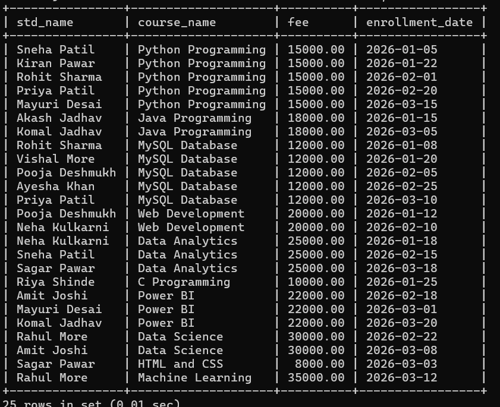

### Q2. Find all students who are currently enrolled in Python Programming.
Query: 
 SELECT s.std_name
FROM students AS s
JOIN enrollments AS e ON s.student_id = e.student_id
JOIN courses AS c ON c.course_id = e.course_id
WHERE c.course_name = 'Python Programming';

### Q3. Find the total number of students enrolled in each course.
Query:
 SELECT c.course_name, COUNT(e.student_id) AS total_students
FROM courses AS c
JOIN enrollments AS e ON c.course_id = e.course_id
GROUP BY c.course_id, c.course_name;

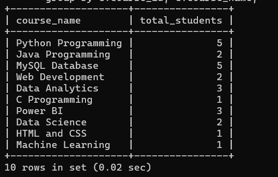

### Q4. Display students whose names start with R.
Query: 
 SELECT *
FROM students
WHERE std_name LIKE 'R%';

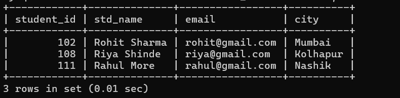

### Q5. Find the student who has spent the highest amount on course fees.
Query:
 SELECT s.std_name, SUM(c.fee) AS total_spent
FROM students AS s
JOIN enrollments AS e ON s.student_id = e.student_id
JOIN courses AS c ON c.course_id = e.course_id
GROUP BY s.student_id, s.std_name
ORDER BY total_spent DESC
LIMIT 1;

### Q6. Find courses whose fee is greater than the average course fee.
Query:
 SELECT course_name
FROM courses
WHERE fee > (SELECT AVG(fee) FROM courses);

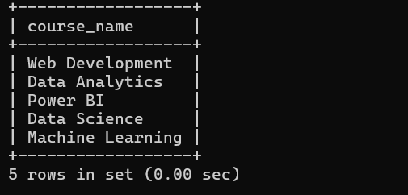

### Q7. Find students who have enrolled in more than one course.
Query:
 SELECT s.std_name, COUNT(e.course_id) AS course_count
FROM students AS s
JOIN enrollments AS e ON s.student_id = e.student_id
GROUP BY s.student_id, s.std_name
HAVING COUNT(e.course_id) > 1;

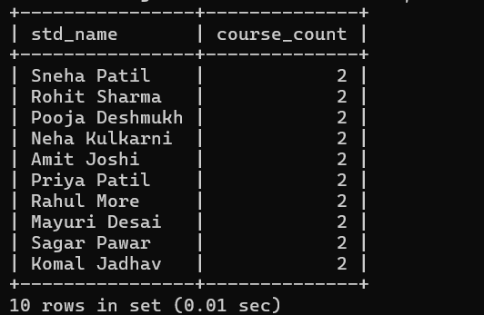

### Q8. Display all courses sorted by fee from highest to lowest.
Query:
 SELECT course_name, fee
FROM courses
ORDER BY fee DESC;

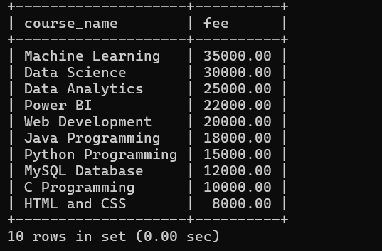

### Q9. Identify the most popular course based on the highest number of enrollments.
Query:
 SELECT c.course_name, COUNT(e.course_id) AS total_enroll
FROM courses AS c
JOIN enrollments AS e ON c.course_id = e.course_id
GROUP BY c.course_id, c.course_name
ORDER BY total_enroll DESC
LIMIT 1;

### Q10. Find the second-highest course fee.
Query:
 SELECT MAX(fee) AS second_highest
FROM courses
WHERE fee < (SELECT MAX(fee) FROM courses);

### Q11. Generate a report showing each student, the number of courses enrolled in, and the total amount spent.
Query:
 SELECT s.std_name,
       COUNT(e.course_id) AS number_of_courses,
       SUM(c.fee) AS total_spent
FROM students AS s
JOIN enrollments AS e ON s.student_id = e.student_id
JOIN courses AS c ON c.course_id = e.course_id
GROUP BY s.student_id, s.std_name;

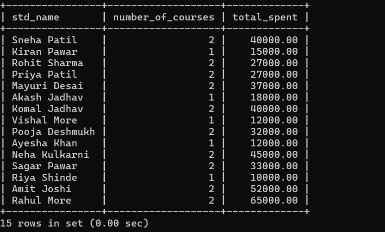

### Q12. Find students who enrolled in a course after February 1, 2026.
Query:
 SELECT s.std_name
FROM students AS s
JOIN enrollments AS e ON s.student_id = e.student_id
WHERE e.enrollment_date > '2026-02-01';

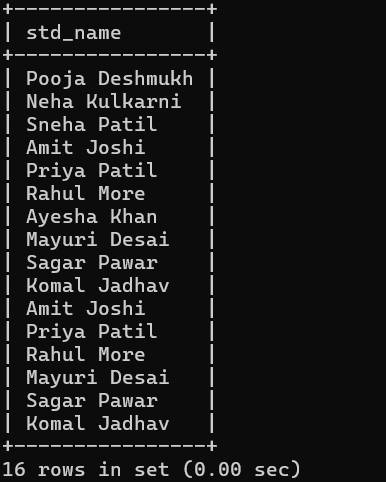

### Q13. Find students who are enrolled in both Python Programming and MySQL Database.
Query:
 SELECT s.std_name
FROM students AS s
JOIN enrollments AS e ON s.student_id = e.student_id
JOIN courses AS c ON c.course_id = e.course_id
WHERE c.course_name IN ('Python Programming', 'MySQL Database')
GROUP BY s.student_id, s.std_name
HAVING COUNT(c.course_name) = 2;

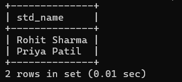

### Q14. Display the top 3 courses based on the number of students enrolled.
Query:
 SELECT c.course_name, COUNT(e.student_id) AS total_enrollments
FROM courses AS c
JOIN enrollments AS e ON c.course_id = e.course_id
GROUP BY c.course_id, c.course_name
ORDER BY total_enrollments DESC
LIMIT 3;

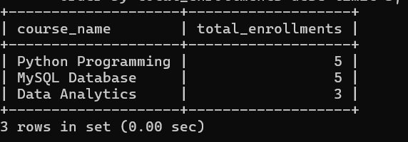

### Q15. Display all courses with a fee less than 15,000.
Query:
 SELECT *
FROM courses
WHERE fee < 15000;

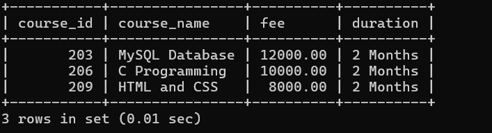

### Q16. Display all students along with their enrollment date.
Query:
 SELECT s.std_name, e.enrollment_date
FROM students AS s
JOIN enrollments AS e ON s.student_id = e.student_id;

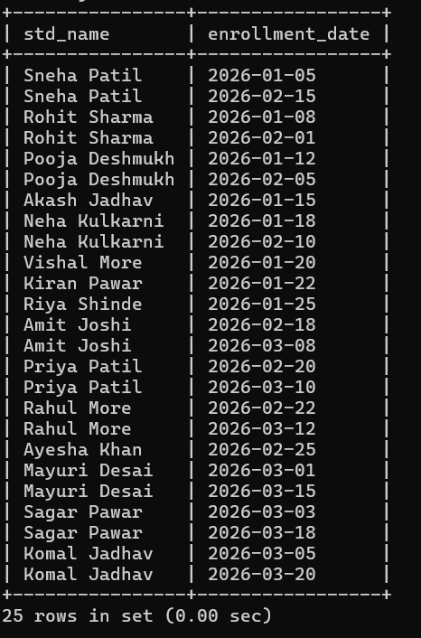

## 5. Working of the System

The Course Enrollment System works by storing student, course, and
enrollment details in three related tables. Students can be enrolled in
different courses, and their enrollment details are recorded with the
enrollment date. SQL queries are used to retrieve and analyze the stored
information and generate useful reports.

## 6. Features

-   **Student Management:** Stores student details.
-   **Course Management:** Stores course name, fee, and duration.
-   **Enrollment Management:** Records student course enrollments.
-   **Data Retrieval:** Easily searches and displays required
    information.
-   **Report Generation:** Generates useful course and enrollment
    reports.

## 7. Advantages

-   Saves time and keeps student and course data organized.
-   Provides accurate information.
-   Makes reporting easy.

## 8. Limitations

-   The system is mainly dependent on the database and SQL knowledge.
-   It does not provide a real-time online enrollment facility.

## 9. Future Scope

In the future, the Course Enrollment System can be developed into a
complete web-based application. Features such as online enrollment,
student login, online payment, course availability, and notifications
can be added to make the system more useful and user-friendly.

## 10. Conclusion

The Course Enrollment System provides an efficient way to manage
student, course, and enrollment information. It helps store data
systematically and retrieve useful information using SQL queries.
Overall, the system makes data management simple, accurate, and
organized.
